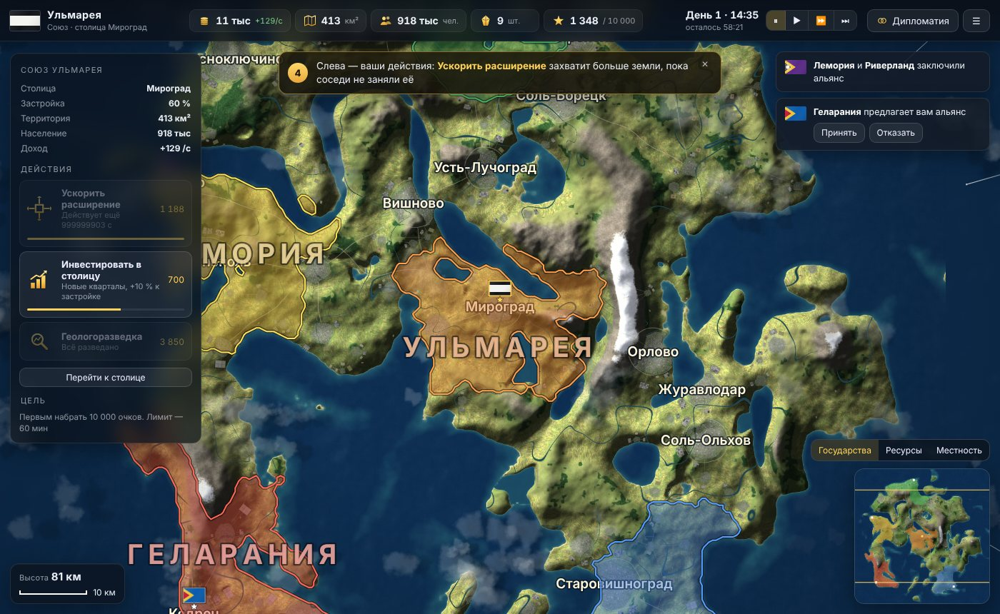
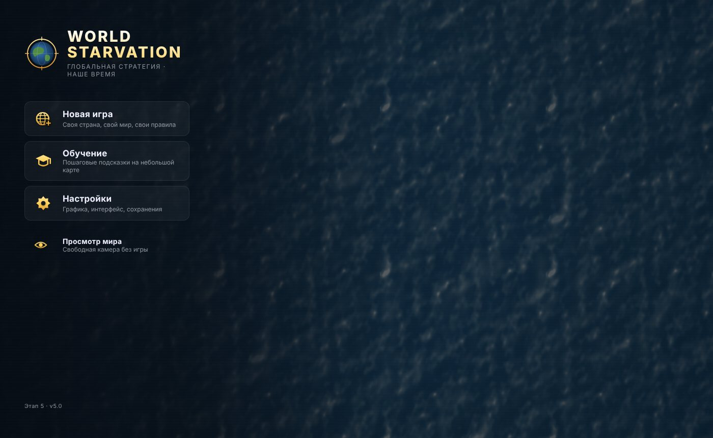
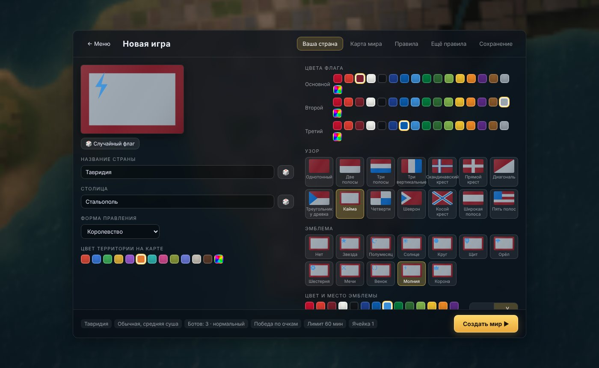
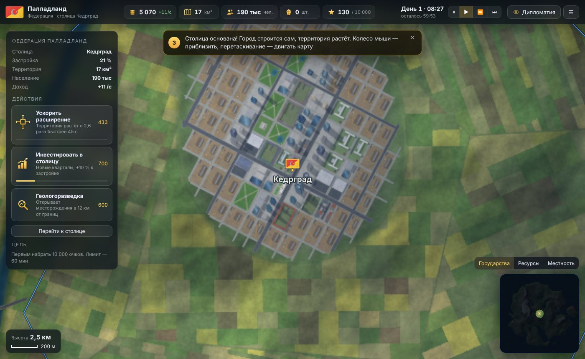
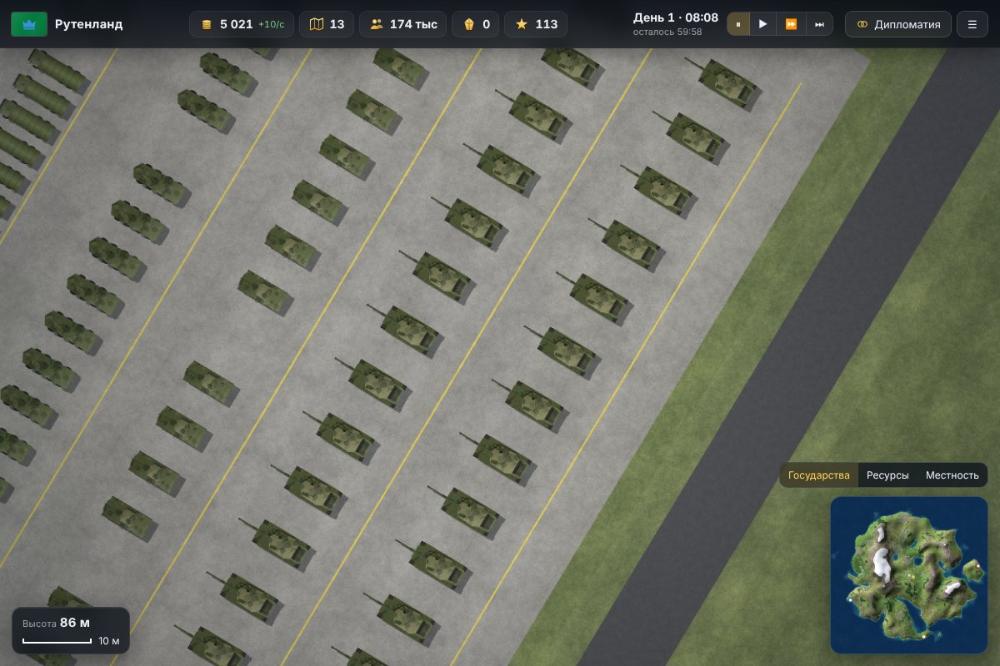
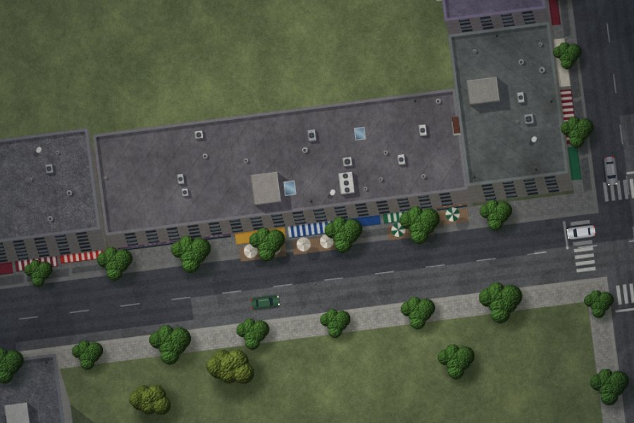
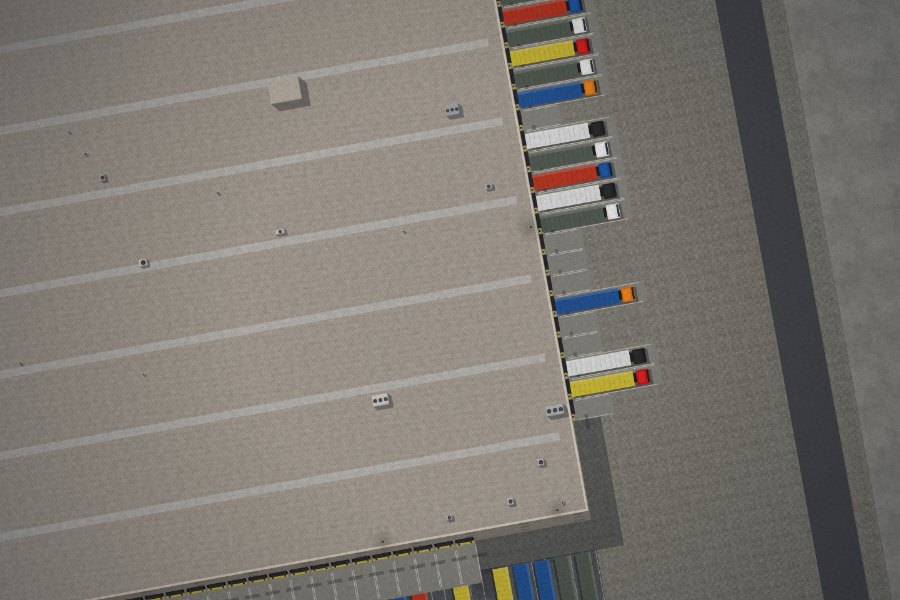

# WorldStarvation — глобальная стратегия в наше время

Браузерная стратегия в духе Hearts of Iron на огромном процедурном мире с видом сверху. Время действия — наши дни: вы основываете своё государство, его столица сама вырастает на карте, граница расползается по равнинам и вдоль рек, соседи-боты делают то же самое. Под картой работает «Живой мир» этапов 1–4: города, сёла, дороги и развязки, транспорт, заводы, порты, смена дня и ночи, сезоны и погода. Мир 131×131 км целиком строится из seed. Графика — Canvas 2D, тайлы рендерятся в Web Workers. Сборщики и зависимости для запуска не нужны.

**Текущая версия — этап 5**: главное меню, настройка новой игры (страна и флаг, тип карты с предпросмотром, правила, боты, сохранения), основание столиц, рост городов и территорий, экономика и месторождения, туман войны, альянсы, сохранения. Новые модели: правительственный квартал с куполом и флагами, военные базы с бронетехникой, вертолётами и ПВО.

**Играть онлайн:** https://qwistiii.github.io/WorldStarvation/



| | |
| --- | --- |
|  |  |
|  |  |

## Как играть

1. **Новая игра** → настройте страну (название, столица, форма правления, флаг: цвета, узор, эмблема; цвет территории), карту (обычная, материки, архипелаг, острова; размер суши, реки, озёра; сид с кубиком и предпросмотр), правила и соперников, выберите ячейку сохранения → **Создать мир**.
2. Подсказка 1: **выберите место для столицы**. Слева «Основать столицу» (✕ — отмена), затем клик по карте → «Основать столицу здесь?» → **Да**. Боты в этот же момент выбирают свои столицы, мир перестраивается: столицы встают ровно там, где основаны, между государствами прокладываются магистрали.
3. Столица застраивается сама: сначала улицы, потом стройплощадки, потом кварталы. Территория растёт от столицы — быстрее по равнинам, медленнее в горах, через узкие проливы.
4. Казна пополняется от территории, населения и месторождений внутри границ. Действия: **Ускорить расширение**, **Инвестировать в столицу**, **Геологоразведка**. Дипломатия — альянсы (союзники делятся обзором).
5. Победа — по очкам, по времени или (с появлением армии) захватом столиц.

Клавиши в игре: `Пробел` — пауза, `1`/`2`/`3` — скорость ×1/×2/×4, `Esc` — меню паузы (сохранить, настройки, выход). Колесо — масштаб, перетаскивание — карта, клик по городу — сведения о нём.

Адрес с seed (`index.html#1337`) открывает режим разработчика — мир без игры, для инструментов и тестов.

## Запуск

**Вариант 1 — просто открыть.** Скачайте репозиторий и откройте `index.html` в Chrome, Edge, Firefox или Safari 16.4+.

**Вариант 2 — через локальный сервер** (нужен Node.js 18+):

```bash
npm start            # → http://localhost:8080
```

### Параметры в адресе (hash)

| Пример | Что делает |
| --- | --- |
| `#1337` | seed мира (по умолчанию 20261107) |
| `#1337,t23` | время суток, часы (23 — ночь) |
| `,s0` / `,s1` / `,s2` | сезон: лето / осень / зима |
| `,w0`…`,w6` | погода: ясно, переменная облачность, пасмурно, дождь, гроза, снег, туман |
| `#1337cpu` | без Web Workers, всё в main thread (для отладки) |

Пример: `index.html#20261107,t22,s2,w5` — зимняя ночь со снегопадом.

### Управление

- Колесо или щипок — масштаб; перетаскивание — движение; двойной клик — приблизить
- WASD или стрелки — движение, `+`/`−` — масштаб
- Клик по городу или объекту — инспектор, `Esc` — закрыть
- `N` — переключить день и ночь, `P` — пауза времени (в режиме просмотра)

## Структура

```
index.html        разметка: меню, экраны настройки, HUD игры, панель просмотра; подключает src/*
src/style.css     единый стиль интерфейса (дизайн-система этапа 5)
src/flag.js       FlagArt() — флаги государств: узоры и эмблемы (Canvas 2D; уходит и в workers)
src/gen.js        WorldGen(seed, opt) — детерминированный генератор мира и рендер тайлов
                  (выполняется и в main thread, и в каждом Web Worker)
src/main.js       startWorld(cfg) — движок: камера, ввод, кеш тайлов, workers, транспорт, свет, погода
src/game.js       Game — государства, основание столиц, территория, экономика, боты, туман, сохранения
src/ui.js         меню, настройка новой игры, настройки, пауза, процедурные иконки, запуск
tools/build.mjs   сборка в один файл dist/living-world.html
tools/serve.mjs   локальный статический сервер без зависимостей
tools/shot.mjs    скриншоты мест мира для проверки визуала
tools/survey.mjs  обход 16 типовых мест мира (город, село, порт, ТЭЦ, развязка, мост, АЗС…) для любого seed
tools/audit.mjs   аудит геометрии: что на что налезает, с координатами мест
tools/perf.mjs    замер времени рендера тайлов
tests/            тесты генератора, геометрии и игровых миров (Node), браузерные тесты просмотра и игры (Playwright)
archive/          исходные однофайловые версии этапов 1–3 (MD5SUMS — контрольные суммы)
docs/             архитектура, история этапов, скриншоты
```

Worker собирается на лету из `FlagArt.toString() + WorldGen.toString()`, поэтому обе функции должны оставаться самодостаточными (без внешних ссылок).

## Разработка и проверка

```bash
npm test                    # генератор, геометрия и игровые миры в Node (~2,5 мин): эталон seed 1337, детерминизм, ничего ни на что не налезает
npm run build               # dist/living-world.html — однофайловая версия (её можно загрузить в Notion)

npm install                 # один раз: Playwright для браузерного теста
npx playwright install chromium
npm run test:browser        # просмотр (день, ночь, зима, без workers), пиксельные тесты тайлов, игра от меню до «Продолжить»
```

Для проверки визуала: `node tools/shot.mjs` (скриншоты нужных мест мира в `/tmp/shots`), `node tools/survey.mjs <seed>` (обход типовых мест), `node tools/audit.mjs <seed>` (сводка наложений с координатами) и `node tools/perf.mjs` (время рендера тайлов).

В браузере для отладки доступны `Game` (состояние игры `Game.G`, движок `Game.api`), `__ui` и `window.__world`: `setTod(h)`, `setSeason(s)`, `setWeather(i)`, `setSpeed(0|1|2)`, `stop()`, `cam`, `PROF` (профайлер кадра), `stats()`.

## Документация

- [docs/ARCHITECTURE.md](docs/ARCHITECTURE.md) — устройство генератора, тайлов, рендера и транспорта
- [docs/DEVLOG.md](docs/DEVLOG.md) — журнал разработки: что и как сделано, как продолжать работу
- [docs/HISTORY.md](docs/HISTORY.md) — что сделано на этапах 1–4, замеры и идеи

| | |
| --- | --- |
|  |  |
|  |  |
|  |  |
