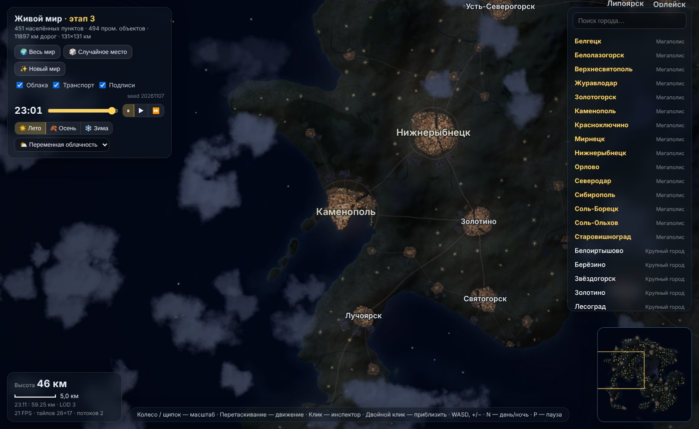
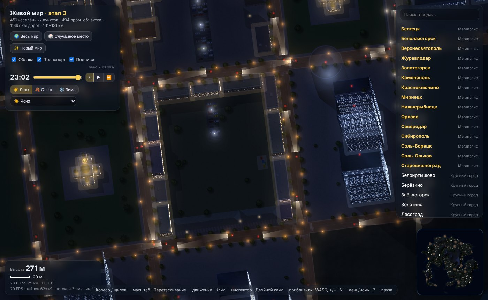
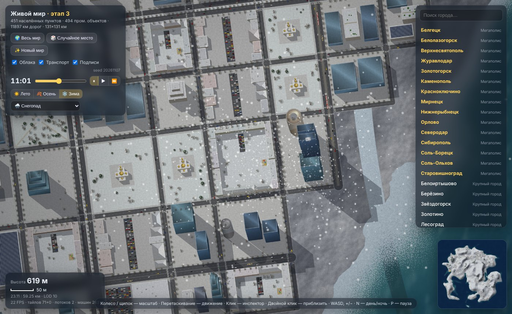
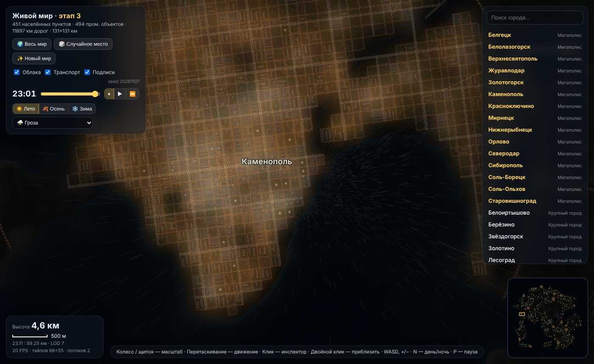
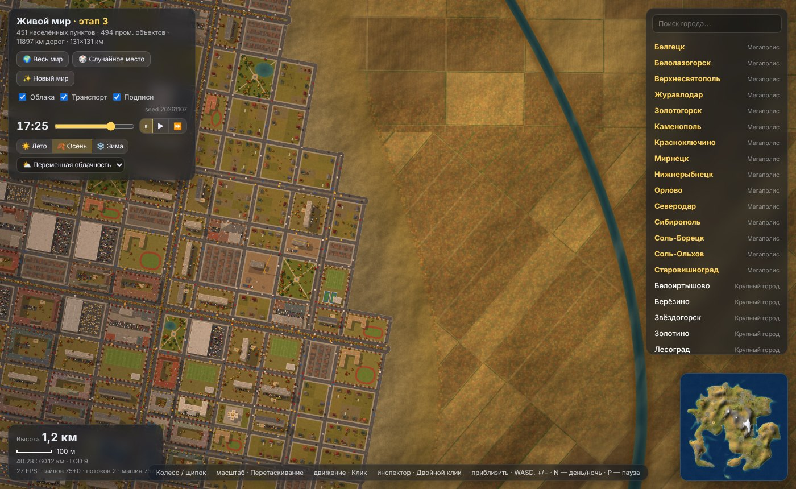

# WorldStarvation — «Живой мир»

Браузерный симулятор огромного процедурного мира с видом сверху. Камера плавно опускается с орбиты до улиц. В мире есть города, сёла, дороги и развязки, транспорт, заводы, НПЗ, порты и аэропорты. Также есть смена дня и ночи, сезоны и погода. Мир размером 131×131 км целиком строится из seed, графика — Canvas 2D, тайлы рендерятся в Web Workers. Сборщики и зависимости для запуска не нужны.

**Текущая версия — этап 4**: процедурные материалы, детальные крыши, поля без швов, переделанный ночной свет.

**Играть онлайн:** https://qwistiii.github.io/WorldStarvation/



## Запуск

**Вариант 1 — просто открыть.** Скачайте репозиторий и откройте `index.html` в Chrome, Edge, Firefox или Safari 16.4+.

**Вариант 2 — через локальный сервер** (нужен Node.js 18+):

```bash
npm start            # → http://localhost:8080
```

### Параметры в адресе (hash)

| Пример | Что делает |
| --- | --- |
| `#1337` | seed мира (по умолчанию 20261107) |
| `#1337,t23` | время суток, часы (23 — ночь) |
| `,s0` / `,s1` / `,s2` | сезон: лето / осень / зима |
| `,w0`…`,w6` | погода: ясно, переменная облачность, пасмурно, дождь, гроза, снег, туман |
| `#1337cpu` | без Web Workers, всё в main thread (для отладки) |

Пример: `index.html#20261107,t22,s2,w5` — зимняя ночь со снегопадом.

### Управление

- Колесо или щипок — масштаб; перетаскивание — движение; двойной клик — приблизить
- WASD или стрелки — движение, `+`/`−` — масштаб
- Клик по городу или объекту — инспектор, `Esc` — закрыть
- `N` — переключить день и ночь, `P` — пауза времени

## Структура

```
index.html        разметка интерфейса; подключает src/*
src/style.css     стили интерфейса
src/gen.js        WorldGen(seed) — детерминированный генератор мира и рендер тайлов
                  (выполняется и в main thread, и в каждом Web Worker)
src/main.js       камера, ввод, кеш тайлов, workers, анимация, свет, погода, UI
tools/build.mjs   сборка в один файл dist/living-world.html
tools/serve.mjs   локальный статический сервер без зависимостей
tools/shot.mjs    скриншоты мест мира для проверки визуала
tools/perf.mjs    замер времени рендера тайлов
tests/            тесты генератора (Node) и браузерный smoke-тест (Playwright)
archive/          исходные однофайловые версии этапов 1–3 (MD5SUMS — контрольные суммы)
docs/             архитектура, история этапов, скриншоты
```

Worker собирается на лету из `WorldGen.toString()`, поэтому генератор должен оставаться одной самодостаточной функцией без внешних зависимостей.

## Разработка и проверка

```bash
npm test                    # генератор в Node: seed 1337 → 433 населённых пункта и 6273 дороги, детерминизм
npm run build               # dist/living-world.html — однофайловая версия (её можно загрузить в Notion)

npm install                 # один раз: Playwright для браузерного теста
npx playwright install chromium
npm run test:browser        # index.html и dist в режимах: день, ночь, зима со снегом, без workers
```

Для проверки визуала: `node tools/shot.mjs` (скриншоты нужных мест мира в `/tmp/shots`) и `node tools/perf.mjs` (время рендера тайлов).

В браузере для отладки доступен `window.__world`: `setTod(h)`, `setSeason(s)`, `setWeather(i)`, `setSpeed(0|1|2)`, `stop()`, `cam`, `PROF` (профайлер кадра), `stats()`.

## Документация

- [docs/ARCHITECTURE.md](docs/ARCHITECTURE.md) — устройство генератора, тайлов, рендера и транспорта
- [docs/DEVLOG.md](docs/DEVLOG.md) — журнал разработки: что и как сделано, как продолжать работу
- [docs/HISTORY.md](docs/HISTORY.md) — что сделано на этапах 1–4, замеры и идеи

| | |
| --- | --- |
|  |  |
|  |  |
