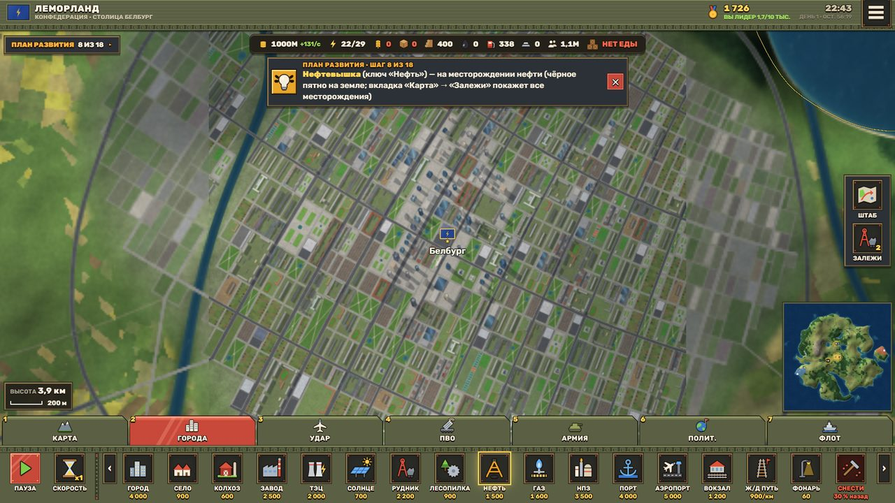
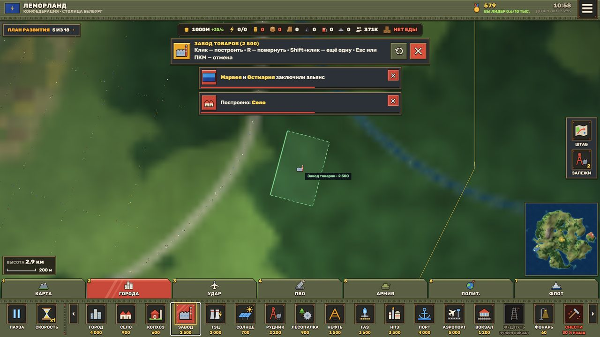
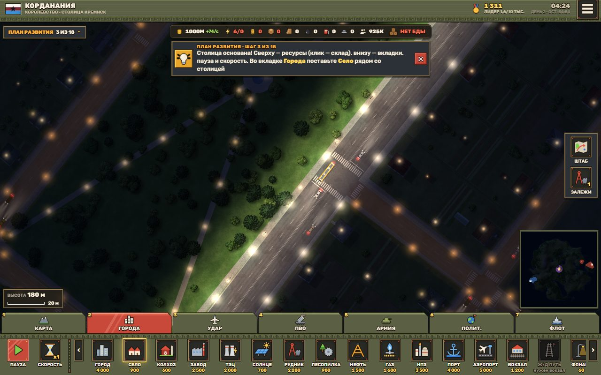
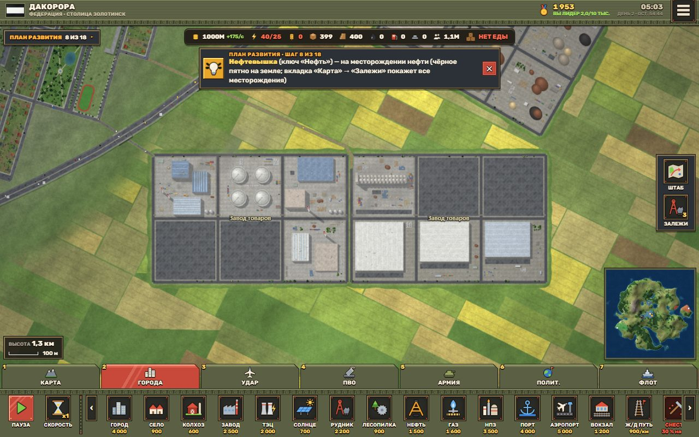
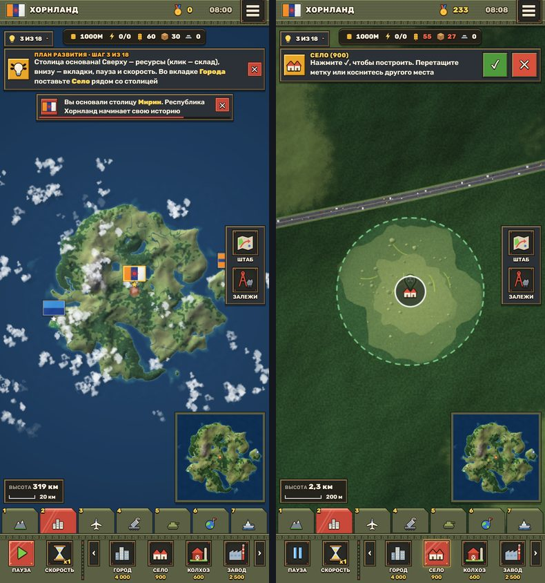

# World Starvation

**Браузерная стратегия наших дней на огромном процедурном мире.** Вы основываете своё государство, строите города, заводы, энергетику, транспорт и армию, соперничаете с ботами — на карте 131 × 131 км, которая целиком рождается из одного числа-сида. Вид сверху с настоящим ощущением высоты: облака, самолёты и фонари висят над землёй и при движении камеры смещаются с разной скоростью.

Работает в браузере на ПК и телефоне, ничего устанавливать не нужно. Интерфейс сделан по образцу DroneFlames.

**▶ Играть онлайн:** https://qwistiii.github.io/WorldStarvation/



| | |
| --- | --- |
|  |  |
|  |  |

## Что в игре

- **Живой мир.** Рельеф, реки, леса, поля, города с разной планировкой, сёла, дороги и развязки, железные дороги, порты, аэропорты. Транспорт, поезда, корабли и самолёты движутся сами. День и ночь, сезоны, погода — от ясного неба до грозы и снегопада.
- **Высота и параллакс.** Облака, самолёты и головы фонарей висят на своей высоте: при движении камеры они смещаются быстрее земли, тени падают по солнцу. Мир выглядит объёмным, а не плоской картой.
- **Своё государство.** Столица растёт сама, территория расширяется. Экономика: еда, товары, энергия, древесина, нефть, топливо, металл, склад и торговля через порты.
- **Строительство.** Город, село, колхоз, завод, ТЭЦ, солнечные панели, рудник, лесопилка, нефтевышка, газовая скважина, НПЗ, порт, аэропорт, вокзал и ЖД-пути, фонари, военная часть, ПВО, дронопорт с модулями, цех БПЛА. Вокруг каждой постройки земля перестраивается: поля заканчиваются межой, появляется обочина и утоптанная земля.
- **Свет.** Фонари и прожекторы — настоящие объекты: ночью освещают землю, дома и машины вокруг себя. У фонаря три режима — авто (по времени суток), вкл, выкл.
- **Соперники.** Боты основывают свои государства, строятся, заключают союзы и воюют: армии, дроны (Ланцет, Герань-3, Орлан-10), ПВО, туман войны.
- **Сохранения** в браузере, несколько ячеек.

## Как играть

1. **Новая игра** → настройте страну (название, столица, флаг, цвет), карту (тип, размер суши, реки, горы, сид) и соперников → **Создать мир**.
2. **Основать столицу**: кликните по карте, где ей стоять (лучше равнина у реки или моря) → **Да**.
3. Внизу — вкладки 1–7 (Карта, Города, Удар, ПВО, Армия, Полит., Флот) и ключи построек. Слева — «План развития»: он ведёт по шагам от села до армии.
4. Победа — по очкам, по времени или захватом столиц.

### Управление

| Действие | ПК | Телефон |
| --- | --- | --- |
| Двигать карту | перетаскивание мышью, WASD / стрелки | палец |
| Масштаб | колесо, `+` / `−`, двойной клик | щипок двумя пальцами |
| Поставить постройку | ключ внизу → клик по карте | ключ → метка в центре экрана → перетащите → ✓ |
| Повернуть постройку | `R` (на 15°), `Shift+R` (на 90°) | кнопка ⟲ |
| Поставить ещё одну такую же | `Shift+клик` | — |
| Отменить | `Esc`, правая кнопка мыши, ✕, повторное нажатие ключа | ✕ или повторное нажатие ключа |
| Выбрать постройку или армию | клик | тап |
| Пауза / скорость | `Пробел` / `F` | кнопки слева внизу |
| Вкладки | `1`–`7` | тап |
| Меню | `Esc` | ☰ |
| Замер FPS | `F3` | — |

## Запуск у себя

Нужен браузер с WebGL2: Chrome, Edge, Firefox или Safari 16.4+.

**Просто открыть:** скачайте репозиторий и откройте `index.html`.

**Через локальный сервер** (Node.js 18+):

```bash
npm install
npm start            # → http://localhost:8080
```

`npm run build` собирает всю игру в один файл `dist/living-world.html`.

> На ноутбуке с двумя видеокартами Chrome по умолчанию работает на встроенной. Для максимального FPS: «Параметры Windows → Дисплей → Графика» → Chrome → «Высокая производительность».

### Режим просмотра мира (для разработки)

Адрес с сидом открывает мир без игры: `index.html#1337`. Дополнительно: `,t23` — время суток, `,s0`/`,s1`/`,s2` — лето/осень/зима, `,w0`…`,w6` — погода (ясно … туман), `cpu` — без Web Workers. Пример: `index.html#20261107,t22,s2,w5` — зимняя ночь со снегопадом.

## Производительность

Кадр собирается на WebGL2: однотипные объекты рисуются пачками, тайлы карты лежат в массивах текстур с ограниченной памятью, освещение, виньетка и тени облаков считаются в шейдерах, а не отдельными проходами.

| | Этап 5.13 (Canvas 2D) | Этап 6 (WebGL2) |
| --- | --- | --- |
| ПК 1920×1080, встроенная Intel UHD | 15–40 FPS | 160–309 FPS |
| ПК, RTX 4050 | — | 830–940 FPS |
| Телефон 390×844 (эмуляция, CPU ×4) | 19–50 FPS | 205–455 FPS |
| Вызовов отрисовки за кадр | до 900 | 5–36 |

Методика и сырые цифры — `tests/perf/bench.mjs`, `bench/baseline.json` → `bench/final.json`.

## Для разработчика

```bash
npm test              # юнит-тесты + браузерный сценарий на ПК и телефоне (Playwright)
npm run test:unit     # только юнит-тесты (меньше секунды)
npm run test:legacy   # тесты генератора мира: детерминизм сида, геометрия, экономика
npm run test:mechanics # браузерные тесты механик этапа 5 (рейсы, ЖД, туман войны, армии; ~6 мин)
npm run bench         # замер кадра: CPU+GPU, вызовы отрисовки, память, загрузка → bench/<метка>.json
npm run parity        # попиксельное сравнение картинки с веткой main
```

Перед первым браузерным тестом: `npx playwright install chromium`. Скриншоты сценария сохраняются в `.work/e2e/`.

### Структура

```
index.html          разметка: меню, настройка новой игры, HUD, подключение src/*
src/style.css       стиль (HUD как в DroneFlames), шрифт Rubik (src/fonts, OFL)
src/gen.js          WorldGen(seed) — детерминированный генератор мира и рендер тайлов (main thread и Web Workers)
src/parallax.js     Parallax — формулы высоты и параллакса (облака, самолёты, фонари, тени)
src/gl.js           GL2D — рендер кадра на WebGL2 с API, похожим на Canvas 2D
src/place.js        Placement — установка построек: призрак, поворот, подтверждение и отмена
src/lights.js       LightSystem — источники света: режимы, время суток, отсечение, лимит
src/main.js         startWorld() — движок: камера, ввод, тайлы, транспорт, погода, облака, свет
src/game.js         Game — государства, экономика, постройки, армии, боты, туман войны, сохранения
src/ui.js           меню, настройки, иконки, «Что нового»
src/flag.js         флаги государств
tests/unit/         юнит-тесты (Node)
tests/e2e/run.mjs   браузерный сценарий: панели, все постройки, отмена, параллакс, свет, бюджет кадра
tests/perf/         замеры производительности
tests/visual/       паритет со старой версией, снимки построек и фонарей
tools/              сервер, сборка в один файл, служебные скрипты
docs/               архитектура (ARCHITECTURE.md), история этапов, скриншоты
archive/            однофайловые сборки ранних этапов 1–3
```

Подробно об устройстве движка — [docs/ARCHITECTURE.md](docs/ARCHITECTURE.md).
