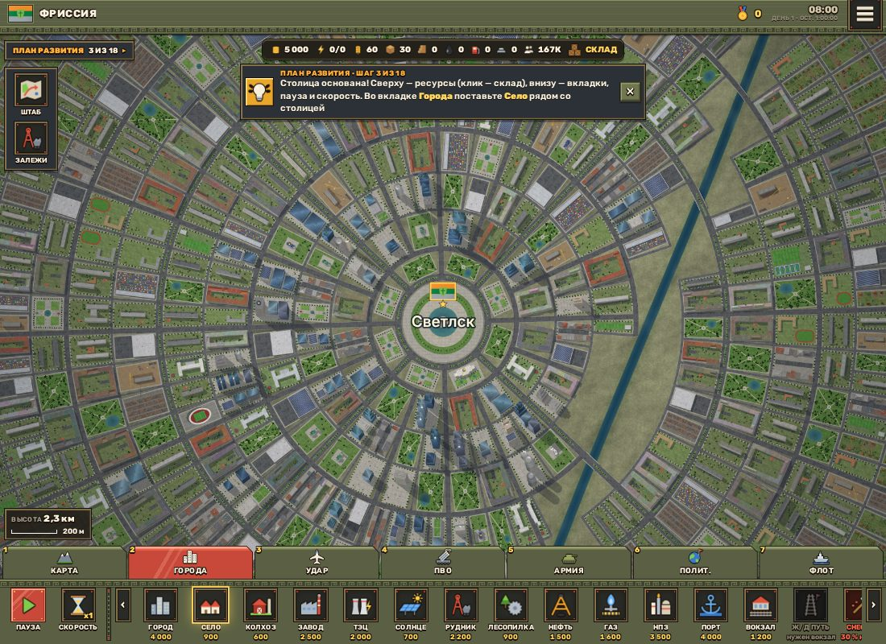
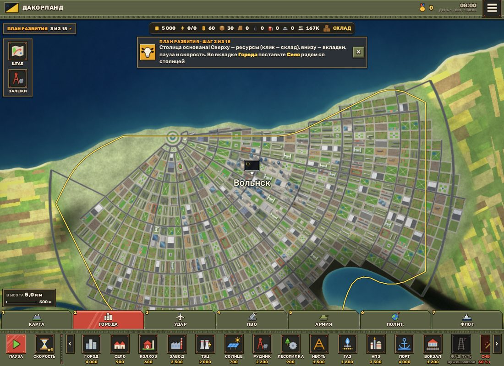
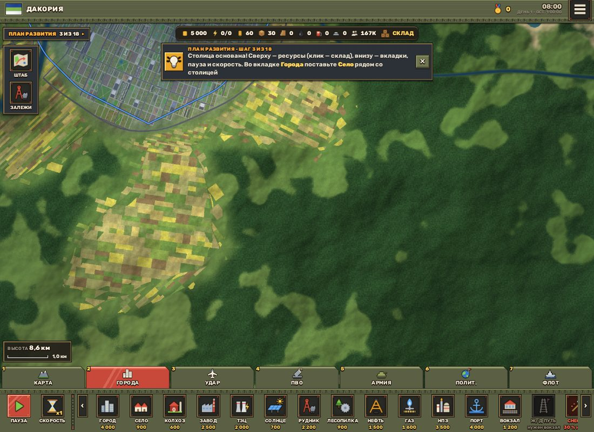
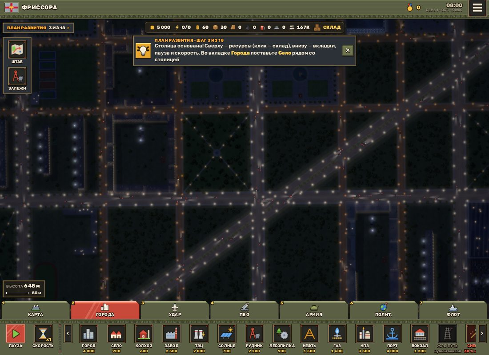
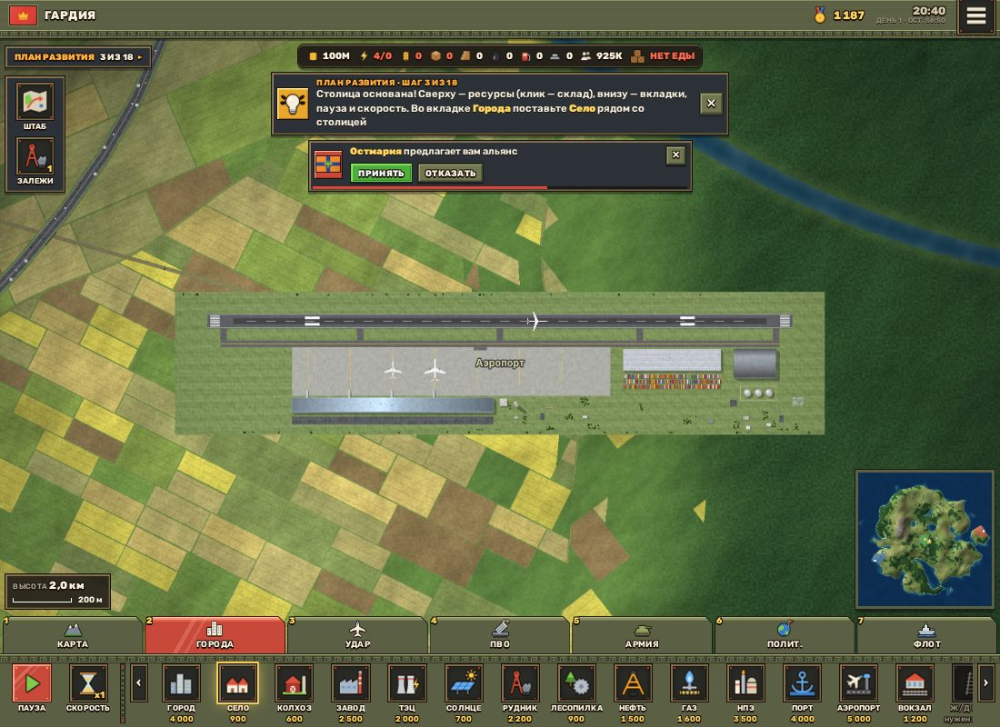
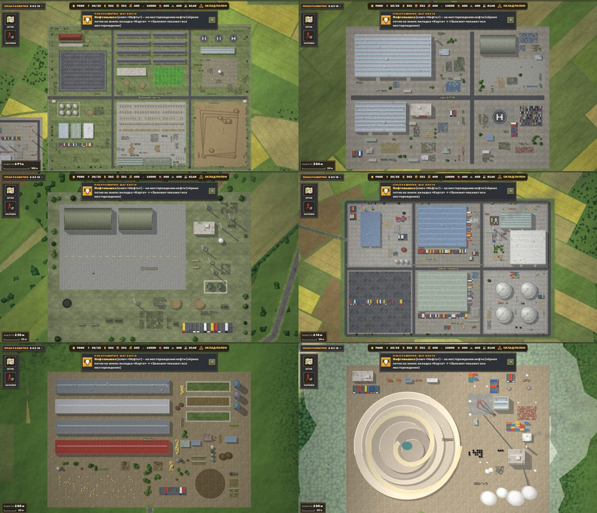
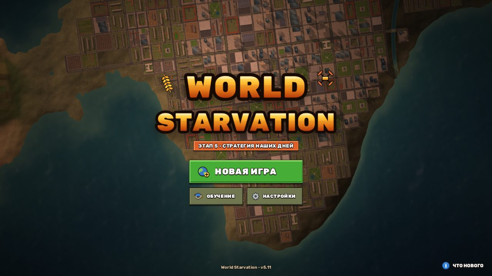

# Этап 5.11: как город перестал быть решёткой (и ещё шесть пунктов)

> Разбор PR #6 «Этап 5.11». Здесь закрыты пункты 1, 3, 4, 6, 9, 14 и 15 из 15 замечаний владельца. Классический мир (без параметров) не изменился ни в одном бите.

## Background

### Для тех, кто видит проект впервые

World Starvation — браузерная стратегия на процедурном мире 131 × 131 км. Весь мир получается из одного числа (сида): его строит функция `WorldGen(seed, opt)` в `src/gen.js`. Она работает и в главном потоке, и в каждом Web Worker. Рабочие потоки сами рисуют тайлы карты 256 × 256 пикселей.

Поэтому генератор обязан быть **детерминированным**: одни и те же входные данные везде дают один и тот же мир. Всё, что игра меняет во время партии (новые сёла, заводы, рельсы), рассылается всем потокам как журнал операций (`api.op(...)`), и каждый поток применяет его у себя.

Состояние государств и экономику хранит игра (`src/game.js`). Движок (`src/main.js`) отвечает за камеру, кэш тайлов, транспорт, свет и облака. Интерфейс — это `src/ui.js`, `index.html` и `src/style.css`.

> 💡 **Ключевое понятие — рамка квартала.** Город — это сетка линий `us[i]` и `vs[j]` в его собственной системе координат (u, v). Квартал (bi, bj) — прямоугольник между соседними линиями. Его рисует `genBlock` в локальной рамке `blkFrame` = [центр x, центр y, cos, sin, полуширина, полувысота]. Через эту рамку работает всё остальное: тени, огни, рост столицы, аудит геометрии.

### Что было до этого PR

В 5.7 сетку городов игры начали изгибать конформным отображением w = z + a·z²/L + b·z³/L². Улицы стали дугами, но устройство сетки осталось прежним: каждая клетка — квартал, каждое ребро — улица, проспект на каждой 4-й линии, бульвар на каждой 8-й. Владелец увидел ровно это: «дороги стали дугами, но кварталы как были квадратные, так и остались».

Остальные пункты касались других частей игры:

- **поля** игрового мира решались целыми системами Вороного, поэтому край пашни шёл прямыми рёбрами с углами;
- **фонари** рисовались аддитивно: на перекрёстках пятна складывались, а у полосы света были резкие края;
- **площадки построек** были пустыми плоскостями;
- **железная дорога** шла по прямой и упиралась в ошибку «мешает город»;
- **аэропорта** в игре не было;
- **меню и настройки** оставались в старом тёмном стиле, хотя HUD партии уже был сделан как в DroneFlames.

## Intuition

### Город: клетка сетки больше не обязана быть кварталом

Главная идея — отделить **сетку** от **кварталов**. Квартал может занимать несколько клеток: `c.sp` хранит размах в его первой клетке, `c.ms` — ссылку на неё в остальных клетках. Тогда улица проходит не по каждому ребру сетки, а только между **разными** кварталами (`gridStreets`).

Простой пример — полоса из четырёх клеток:

```
до:     |A|B|C|D|      4 квартала, 5 поперечных улиц
после:  |A A|C|D|      A занял 2 клетки: улица между A и A исчезла,
                       а в соседних рядах на её месте Т-образные перекрёстки
```

На этой же идее держится **полярный город**. Его сетка (u, v) — расстояние от центра и угол. Кольца — линии u = const, лучи — линии v = const. Лучей много (кратно 32), чтобы на окраинах кварталы не были огромными. Но у центра окружность короткая, и клетки там превращаются в щели шириной 7 м. Поэтому клетки кольца сливаются по 2, 4, 8 или 16:

```
кольцо 0  (r ≈ 150 м): клетка 7 м  → слить по 16 → 118 м
кольцо 4  (r ≈ 600 м): клетка 29 м → слить по 4  → 117 м
кольцо 12 (r ≈ 2 км):  клетка 98 м → не сливать
```

> ⚠️ **Сектор — не прямоугольник.** `genBlock` умеет рисовать только прямоугольники. Поэтому в секторе берётся наибольший прямоугольник на его среднем луче. Полуширина равна r₀·tan(Δθ/2), где r₀ — радиус внутренней дуги, а внешний край отступает так, чтобы углы не выходили за внешнюю дугу. У внешних углов остаются треугольные зазоры с городским грунтом.

Семейства планировок (`c.lay`):

- `radial` — кольца и лучи вокруг площади;
- `fan` — веер от площади на краю города, раскрытый туда, где больше суши;
- `grid` — прямая сетка и 1–2 диагональных бульвара;
- `bent` и `organic` — изогнутые сетки с суперкварталами.

У столиц одной партии семейство сдвигается на номер государства, поэтому их планировки всегда разные.





### Ландшафт: изогнуть границу, а не размыть её

Каждая система полей по-прежнему решается целиком: так выглядят настоящие поля. Но систему теперь ищут через **плавное искажение координат**. Точка (x, y) сначала сдвигается шумом примерно на ±400 м, и только потом определяется, в какую систему она попала. Прямые рёбра Вороного от этого становятся кривыми.

Лес у пашни редеет через опушку. Её ширина считается по расстоянию до ближайшей **распаханной** системы, а не до ближайшей системы вообще. Иначе опушка обрывалась бы там, где соседняя система тоже дикая.



### Свет: максимум вместо суммы

Чтобы перекрёсток двух улиц светился так же, как одна улица, свет нужно складывать по максимуму, а не суммировать. В Canvas для этого есть `lighten` (максимум по каналам), но с прозрачностью он работает не как настоящий максимум. Поэтому слой света сначала рисуется **непрозрачной яркостью на чёрном фоне**. Затем он переводится обратно в «свет с альфой»: альфа равна самому яркому каналу.



### Железная дорога: найти путь, затем сгладить

Путь ищет A* по сетке с шагом 110–260 м. Стоимость клеток:

- центры городов закрыты, застройка стоит очень дорого, окраины — дороже обычной земли;
- сёла, постройки и вокзалы закрыты вместе с запасом вокруг;
- горы закрыты, вода стоит дорого (там нужен мост).

Поиск начинается и заканчивается в точках на продолжении выводов вокзалов, поэтому путь подходит к вокзалу прямо, по его оси. Ступенчатый путь по клеткам выпрямляется, разбивается на отрезки по 60 м и сглаживается. В итоге получаются дуги радиусом в сотни метров.

### Аэропорт: рейс как настоящий полёт

Рейс — одна поездка по ломаной:

1. разбег по своей ВПП в сторону цели;
2. набор высоты;
3. крейсерский полёт;
4. заход за 9 км по оси ВПП аэропорта назначения;
5. посадка и пробег.

Сколько метров пролетел самолёт, игра считает по игровому времени (`flAt`), поэтому пауза и скорость игры на полёт действуют. Движок рисует такой самолёт тем же кодом, что и самолёты мира: с высотой, тенью от солнца и огнями ночью.



## Code

### 1. Городские планировки (`src/gen.js`)

Главное изменение — флаг `c.cv` (кривая сетка: изогнутая или полярная). Он заменил проверки `c.wp` по всему коду. Кроме того, везде, где раньше бралось `us[bi+1]`, теперь учитывается размах квартала:

```javascript
function blkSpan(c,bi,bj){if(!c.sp)return SP11;const q=c.sp[bj*(c.D-1)+bi];return q?[(q&15)+1,(q>>4)+1]:SP11}
function blkFrame(c,bi,bj){const sp=blkSpan(c,bi,bj),u0=c.us[bi],u1=c.us[bi+sp[0]],v0=c.vs[bj],v1=c.vs[bj+sp[1]];
  if(c.pol){ /* наибольший прямоугольник в секторе */ ... }
  ...}
```

Улицы строятся по группам кварталов:

```javascript
// ребро — улица, если оно разделяет разные кварталы (или квартал и пустую землю)
const a=grpAt(c,i,j-1),b=grpAt(c,i,j);e=(a>=0||b>=0)&&a!==b;
```

Защита от наложений:

- проспекты и бульвары не прерываются: через их линии кварталы не сливаются, иначе широкая улица упиралась бы концом в квартал;
- в изогнутой сетке слияние проверяет `blkFits`: края прямоугольника должны быть не дальше 2,5 м от кривых улиц;
- узкий квартал (полуширина меньше 34 м) становится сквером или площадью: школа или стройка в 40-метровом квартале вылезала на проспект;
- `throughClear` (кварталы под магистралями) и `snapNodeG` (узел, где кончается дорога) учитывают суперкварталы.

Новые типы кварталов: 22 — микрорайон, 23 — площадь. Кварталы для тайла ищутся с запасом на размах (`c.msi`, `c.msj`). Иначе большой квартал пропадал бы на краю тайла.

### 2. Поля и лес (`raster`)

```javascript
// сетка 4 px: смещение для поиска системы полей
if(EMPTY){gQX[k]=noise(wx/2100+5.3,wy/2100-2.7)*330+noise(wx/640+1.9,wy/640+7.7)*70; ...}
// пиксель дикой системы → опушка по расстоянию до ближайшей распаханной
if(!f1){let dP=1e9;for(...)dP=M.min(dP,(dd-q1)/(2*|c_q-c_i1|));fe=smooth(bd+160,bd*0.3,dP)*0.92}
```

Лес под посевами убирается только после того, как каждый участок решил, распахан ли он (`clr()`). Раньше это делалось до решения, и на краю полосы участков стояла сплошная стенка леса.

### 3. Свет фонарей (`lightRoads`)

Слой `LG_` — чёрный фон, на нём непрозрачные спрайты пятен (`poolO`) со смешиванием `lighten`. Полоса света вдоль дороги — три вложенных штриха на временном слое. Затем слой переводится в альфу и добавляется к тайлу через `lighter`. Пиксели читаются с `willReadFrequently`.

### 4. Детали построек (`zoneFill`, `zclus`)

Площадка размечается сеткой с шагом 8 м: занятые клетки (здания, резервуары, кучи, проезды, трубы, рельсы с запасом) и свободные. В свободные прямоугольники встают группы деталей по профилю постройки (`ZFILL`). Новый примитив `herd` — стадо. Добавленные детали помечены `fz`, чтобы тест улучшений цеха мог отличить их от основной планировки.



### 5. Железная дорога (`railPts`, `railRoute`, `railSmooth`, `railEnds`)

`railEnds` выбирает, с какого конца вокзала выходит путь. Берётся конец, смотрящий на другой вокзал, если только его вывод не упирается в город или воду. Клетки чужой земли A* закрывает через функцию `blk(x,y)`, которую передаёт игра. Найденный путь кладётся в операцию (`q.P`), и рабочие потоки не ищут его заново. Когда стройка дороги завершается, путь пересчитывается по текущему миру.

### 6. Аэропорт (`game.js`, зона `air2`, `api.gflights`)

`stepFlights` выбирает цель рейса: свой аэропорт или аэропорт мирной страны. Пассажирский рейс в чужую страну возможен только при безвизе (`visa(a,b)`). `landed` при посадке начисляет деньги, а экспортный рейс увозит товары. Безвиз заключают `signVisa` и `askVisa` в дипломатии, `declareWar` его отменяет.

### 7. Меню как в DroneFlames (`index.html`, `ui.js`, `style.css`)

`drawLogo` рисует логотип в Canvas: шрифт Rubik Black, тёмный контур, градиент, светлая полоса и пиксельные строки. Окна новой игры и настроек получили класс `.ol` и правила раздела «stage 5.11»: красные вкладки, переключатели ВКЛ/ВЫКЛ с цветным квадратом, «каменные» кнопки.



## Verification

Что проверено автоматически:

- `npm test` — 55 из 55. Классический мир не изменился бит в бит (это проверяет контрольная сумма).
- `npm run test:browser` — все проверки зелёные, включая новый `tests/game511.mjs`.
- Новые проверки в `tests/stage57.test.mjs`:
  - не меньше 4 семейств планировок, у столиц одной партии они разные;
  - обратное отображение cU(cW) возвращает исходную точку;
  - углы каждого квартала лежат в его клетках или в его секторе;
  - внутри суперкварталов нет улиц, в прямой сетке есть диагональный бульвар;
  - микрорайоны и площади ни на что не налезают, улицы городов не обрываются в пустоте;
  - площадки построек заполнены деталями;
  - ЖД вокруг столицы не заходит в застройку и идёт без изломов: поворот между соседними точками меньше 0,5 рад.
- Общий аудит геометрии (здание на дороге, наложения, вода) прогнан на трёх сидах с пятью столицами и десятком новых городов: нарушений нет.
- `tools/perf.mjs`: дневные тайлы рисуются так же быстро, как в main (разброс ±10 мс). Тайлы огней стали медленнее на 1–3 мс: столько стоит перевод слоя света в альфу.

Как проверить вручную:

1. Откройте сайт и обновите страницу через Ctrl+F5. Должно открыться новое главное меню, справа внизу — «Что нового».
2. Нажмите «Новая игра», посмотрите вкладки и переключатели, затем «Создать мир» и основайте столицу. Отдалите камеру до 5 км: столица не должна быть квадратной сеткой. Столицы соседей можно посмотреть через вкладку «Полит.» → «Показать».
3. Отведите камеру на 8–9 км от города: край пашни кривой, лес переходит в поле через опушку.
4. Поставьте завод, колхоз, рудник и дронопорт: на площадках есть грузы, техника и стада.
5. Ночью (часы на 23:00) приблизьте камеру к перекрёстку: пятна света не складываются.
6. Поставьте два вокзала по разные стороны столицы и проведите ЖД путь: линия огибает город дугой.
7. Поставьте два аэропорта (вкладка «Города» → «Аэропорт»). Примерно через минуту взлетит первый рейс. В «Дипломатии» нажмите «Безвиз» у соседа, у которого есть аэропорт: к нему полетят и пассажирские рейсы.

## Alternatives

### Районы с разными сетками вместо одной обобщённой

Город можно было собрать из нескольких отдельных сеток со своими углами — так выглядят настоящие города, выросшие из сёл.

| Плюсы | Минусы |
| --- | --- |
| Ещё разнообразнее: районы стыкуются под углом | Город стал бы несколькими объектами: пришлось бы переписать рост столицы, население, подписи и владение |
| Каждый район — обычная прямая сетка, секторы не нужны | На стыках районов остаются треугольные пустоты, для них нужен отдельный алгоритм заполнения |

### Полноценный граф улиц с многоугольными кварталами

| Плюсы | Минусы |
| --- | --- |
| Кварталы любой формы, настоящие «старые» города | Генератор кварталов работает только с прямоугольниками: пришлось бы переписать все 23 типа кварталов и аудит |
| Нет зазоров у секторов | Рендер и кэш кварталов стали бы намного дороже, а это риск для FPS |

## Suggested people to talk to

- **Vovan Qwerty** — владелец проекта и автор всех 15 замечаний. Только он может сказать, совпадает ли результат с его скриншотами, особенно по пунктам 6 (переходы текстур) и 9 (свет). В истории коммитов `src/gen.js`, `src/game.js` и `src/main.js` других авторов нет.

## Quiz

<details><summary>1. Почему суперквартал не может объединить клетки через линию проспекта?</summary>

- A) Чтобы кварталов было больше.
- B) Иначе проспект упирался бы концом в квартал, и его скругление залезало бы на дома. ✅
- C) Потому что проспекты рисуются отдельным проходом.

**Ответ: B.** Аудит нашёл бульвары, которые кончались у края суперквартала. Полуширина бульвара — 14,5 м, а дома стоят с отступом, рассчитанным на узкую улицу. A — лишь побочный эффект, а не причина. C неверно: проспекты рисуются вместе с остальными улицами.
</details>

<details><summary>2. Зачем у центра радиального города клетки сливаются по 2, 4, 8 или 16?</summary>

- A) Лучей кратно 32, и на маленьких кольцах клетка превращается в щель шириной в несколько метров. ✅
- B) Чтобы в тайле было меньше дорог.
- C) Так быстрее работает A* для железной дороги.

**Ответ: A.** Ширина клетки равна r·Δθ: при r = 150 м и 128 лучах это 7 м. Слияние по степеням двойки выравнивает кварталы примерно до 120 м, и при этом не остаётся лучей, обрывающихся посреди квартала.
</details>

<details><summary>3. Почему ширина опушки считается по расстоянию до ближайшей распаханной системы, а не по dB — расстоянию до ближайшей границы систем?</summary>

- A) Так дешевле.
- B) dB меняется скачком там, где второй по близости центр — тоже дикая система, и опушка обрывалась резкой стенкой. ✅
- C) dB не учитывает искажение координат.

**Ответ: B.** Это было видно на отладочном снимке: красная зона опушки резко обрывалась. С dP она убывает плавно. dB тоже считается в искажённых координатах, так что C неверно.
</details>

<details><summary>4. Зачем слой света сначала рисуется непрозрачным на чёрном, а потом переводится в альфу?</summary>

- A) `lighten` даёт настоящий максимум только для непрозрачных пикселей; с прозрачностью он работает как «экран». ✅
- B) Чтобы тайл огней стал непрозрачным.
- C) Этого требует bloom.

**Ответ: A.** На прозрачном слое два одинаковых пятна дают C·(2a − a²), а не C·a. Сам тайл огней при этом должен оставаться прозрачным: его альфу читают визуальный тест и смешивание с экраном. Поэтому B — ровно наоборот.
</details>

<details><summary>5. Почему путь ЖД, найденный в игре, передаётся в операции (`q.P`), а не ищется заново в каждом потоке?</summary>

- A) Рабочие потоки не знают, кому принадлежит земля (чужая земля закрыта для поиска), а путь должен везде совпадать. ✅
- B) A* недоступен в рабочих потоках.
- C) Чтобы путь можно было отредактировать вручную.

**Ответ: A.** Владение землёй — состояние игры, генератор о нём не знает. С разными входными данными разные потоки нашли бы разные пути. B неверно: в рабочих потоках работает тот же код `WorldGen`.
</details>
